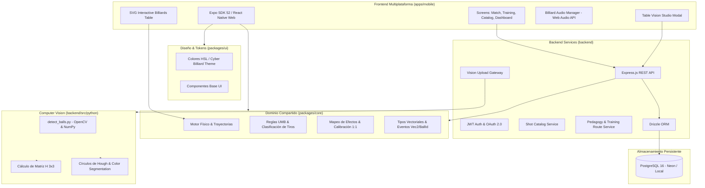
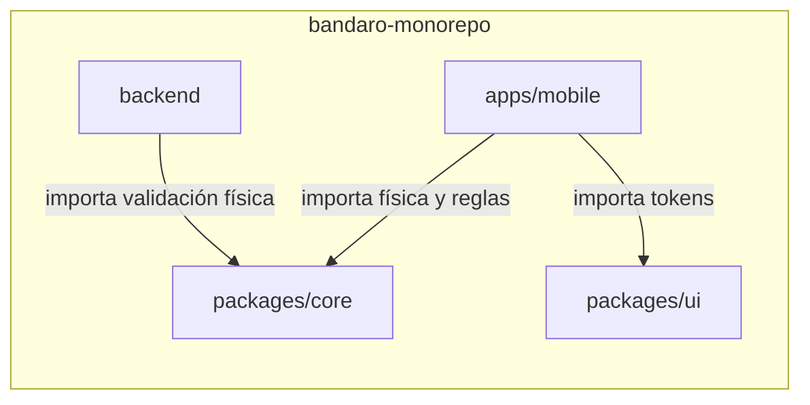
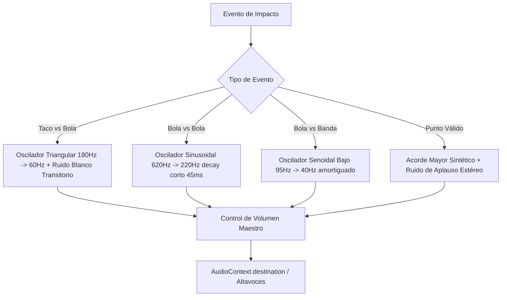

# 🏛️ Arquitectura del Sistema - Bandaro Monorepo

Este documento describe la arquitectura técnica, las capas de software, el grafo de dependencias y el flujo de datos integral de la plataforma **Bandaro**.

---

## 1. Visión General de la Arquitectura

Bandaro está diseñado como un **Monorepo moderno** administrado con **Turborepo** y **pnpm workspaces**, permitiendo compartir tipos, reglas de negocio y física pura entre la aplicación multiplataforma y los servicios de backend.



---

## 2. Estructura de Paquetes y Responsabilidades

### 2.1 `packages/core` (Dominio Puro y Física)
* **Objetivo:** Contener todas las matemáticas vectoriales, simulaciones cinemáticas, validaciones de reglas de juego y traducciones de datos sin ninguna dependencia de React ni React Native.
* **Módulos clave:**
  * `src/physics/physics.ts`: Integrador cinemático cuadro a cuadro, fricción paño-bola, colisión elástica entre esferas y rebotes en bandas con transferencia de momento angular.
  * `src/physics/trajectoryGuide.ts`: Generador de trayectorias predichas en modo Dual (Guía Principal y Guía Secundaria Photoshop-style).
  * `src/physics/powerCalibration.ts`: Calibración 1:1 entre *Largos de Mesa* (1.0 a 5.0) y porcentaje de fuerza.
  * `src/physics/spinMapping.ts`: Conversor bidireccional entre coordenadas cartesianas $[-1, 1]$ y Reloj de billar (1:00 a 12:00) con suelas (0 a 3 tips).
  * `src/rules/threeCushion.ts`: Validador de la regla UMB de 3 bandas y clasificador táctico (`bricole`, `pasebola`, `cajon`, `corrido`, etc.).
  * `src/rules/breakPositions.ts`: Posición canónica de salida de torneo y disposiciones predefinidas.

### 2.2 `apps/mobile` (Aplicación de Usuario Final)
* **Objetivo:** Aplicación interactiva de alto rendimiento compilada con **Expo SDK 52** para iOS, Android y Navegadores Web modernos.
* **Capas internas (`src/`):**
  * `app/`: Enrutamiento declarativo basado en archivos con **Expo Router** (`_layout.tsx`, `index.tsx`, `training/`, `match/`, `catalog/`).
  * `presentation/screens/`:
    * `Dashboard/HomeScreen.tsx`: Pantalla principal con figuras Hairline animadas, estadísticas de racha, accesos rápidos.
    * `Training/`: Ruta de aprendizaje Quetglas, simulador libre de tiros, enciclopedia de sistemas de diamantes.
    * `Catalog/`: Explorador de más de 180 carambolas de maestros mundiales con búsqueda, filtros tácticos y previsualizador 2:1.
    * `Match/`: Marcador en vivo con reloj de tiro oficial de 40 segundos, estadísticas de entrada y series.
  * `presentation/components/`:
    * `Training/InteractiveBilliardsTable.tsx`: Mesa SVG 284x142 cm interactiva con soporte de gestos táctiles y ratón, guías de tiro, ajuste de taco y tacador intercambiable.
    * `Snapshot/TableVisionStudioModal.tsx`: Estudio de calibración fotográfica tipo CamScanner con Scope Óptico 2.8x, D-Pad de precisión y rectificación en tiempo real.
    * `Training/WillieHoppeClock.tsx`: Selector de efectos estilo reloj Willie Hoppe con 12 sectores y 3 círculos concéntricos de suela.
    * `Catalog/ShotCatalogCard.tsx`: Ficha táctica con visualizador de bolas, gauge de velocidad y badges de fuego animados.
  * `presentation/audio/BilliardAudioManager.ts`: Sintetizador de audio procedural con Web Audio API (golpe de taco, choques de bolas, impactos de banda y aplausos).

### 2.3 `backend` (API REST y Orquestador de Servicios)
* **Objetivo:** Servidor Express.js con TypeScript que expone endpoints REST seguros, gestiona la persistencia con Drizzle ORM y coordina los subprocesos de visión artificial.
* **Capas internas (`src/`):**
  * `routes/auth.ts`: Registro, login local (bcrypt), tokens JWT de acceso y refresco, OAuth Google/Microsoft, perfil y rachas.
  * `routes/shots.ts`: Catálogo de tiros con filtros de dificultad, jugador, categoría y traducción trilingüe.
  * `routes/training.ts`: Consulta de niveles, nodos diarios, guardado de sesiones y progreso de estrellas.
  * `routes/vision.ts`: Recepción de imágenes multipart, ejecución de OpenCV y normalización de coordenadas.
  * `db/schema.ts`: Definición de esquema tipado para PostgreSQL con Drizzle ORM.
  * `python/detect_balls.py`: Script en Python que procesa imágenes con OpenCV para detectar esquinas de paño y esferas.

---

## 3. Grafo de Dependencias entre Paquetes



---

## 4. Pipeline de Visión por Computadora (Homografía Proyectiva)

El sistema de visión permite capturar una foto con cualquier perspectiva angular y rectificarla al plano canónico 2:1.

```mermaid
flowchart LR
    Photo[Foto con Perspectiva Arbitraria] --> DetectCorners[Detección de 4 Esquinas Interiores]
    DetectCorners --> CalcH[Cálculo Matriz de Homografía H 3x3]
    CalcH --> Unwarp[Transformación Proyectiva cv2.warpPerspective]
    Unwarp --> PlanarImage[Imagen Aplanada 2:1 Canónica]
    PlanarImage --> DetectBalls[Segmentación HSV + Círculos de Hough]
    DetectBalls --> NormCoords[Coordenadas Normalizadas [0, 1]]
    NormCoords --> PhysicalCoords[Mapeo a Mesa Canónica 284x142 cm]
```

### Formulación Matemática de la Homografía:
Para un punto en la imagen $(u, v, 1)^T$ y su correspondiente punto en la mesa canónica $(X, Y, 1)^T$:
$$\begin{pmatrix} X' \\ Y' \\ W \end{pmatrix} = H \begin{pmatrix} u \\ v \\ 1 \end{pmatrix} = \begin{pmatrix} h_{11} & h_{12} & h_{13} \\ h_{21} & h_{22} & h_{23} \\ h_{31} & h_{32} & h_{33} \end{pmatrix} \begin{pmatrix} u \\ v \\ 1 \end{pmatrix}$$
$$X = \frac{X'}{W}, \quad Y = \frac{Y'}{W}$$

---

## 5. Arquitectura de Audio Procedural

Para eliminar dependencias pesadas de archivos `.mp3` o problemas de latencia, `BilliardAudioManager.ts` genera audio procedural mediante osciladores y curvas de ganancia ADSR en **Web Audio API**:



---

## 6. Pila Tecnológica (Tech Stack Summary)

| Capa | Tecnología | Justificación |
|---|---|---|
| **Gestión Monorepo** | Turborepo + pnpm | Caché inteligente de builds, pipelines concurrentes y gestión estricta de dependencias. |
| **Framework Móvil / Web** | Expo SDK 52 + React Native 0.76 | Un solo código fuente para iOS, Android y Web de alto rendimiento. |
| **Gráficos e Interactividad** | React Native SVG | Renderizado vectorial de alta precisión en mesa de billar (284x142 cm). |
| **Lenguaje** | TypeScript 5.x | Tipado estricto extremo de extremo a extremo (Frontend, Backend, Física). |
| **Servidor API** | Express.js en Node.js 20+ | Liviano, rápido, ideal para APIs REST y streaming de visión. |
| **ORM & Base de Datos** | Drizzle ORM + PostgreSQL 16 | Cero sobrecarga de abstracción (zero-overhead), esquema TypeScript nativo y migraciones seguras. |
| **Visión por Computadora** | Python 3.10 + OpenCV 4.x + NumPy | Algoritmos de visión estándar en la industria para homografía y segmentación cromática. |
| **Testing** | Vitest + Jest | Pruebas unitarias de regresión de física y reglas UMB a 60 FPS. |
