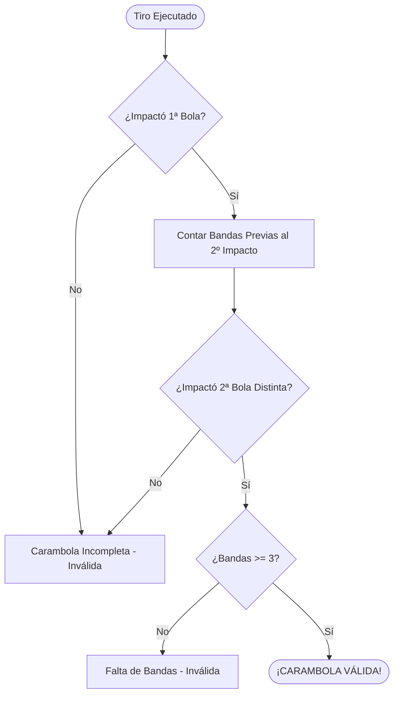
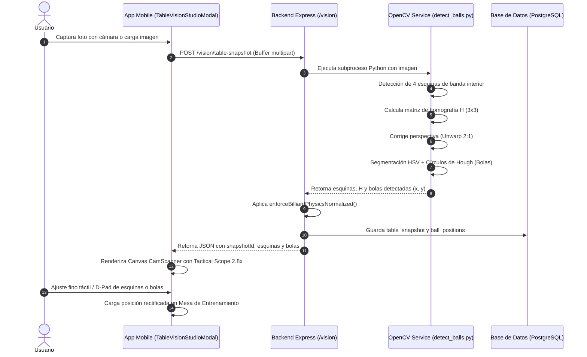
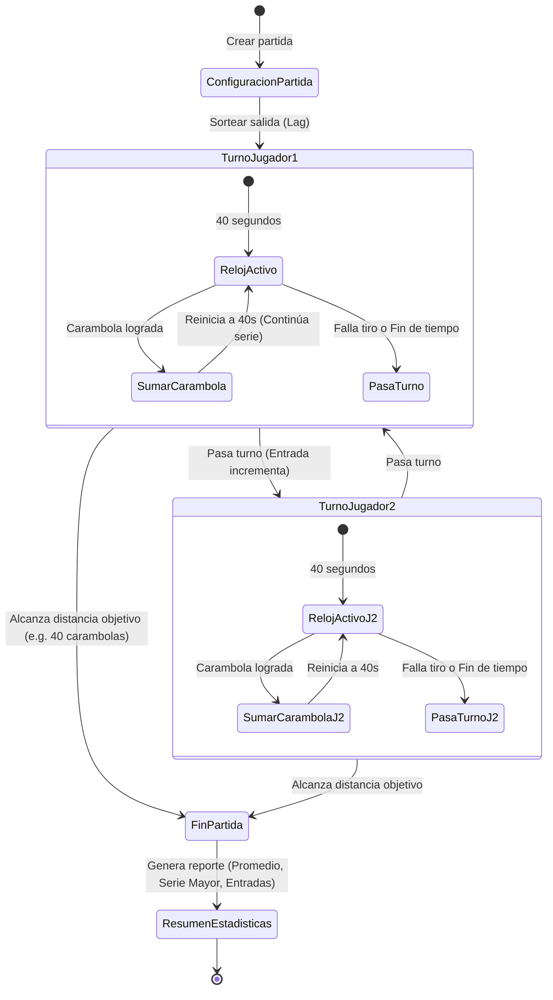

# 📜 Reglas de Negocio y Dominio - Bandaro

Este documento compila de forma exhaustiva las reglas deportivas, matemáticas, biomecánicas y de sistema que gobiernan la plataforma **Bandaro**. Cualquier nuevo desarrollador debe consultar este documento para entender cómo se valida una jugada, cómo opera la física, cómo se calibra la visión por computadora y cómo funciona el sistema pedagógico.

---

## 1. Reglas Oficiales de Juego: Billar a Tres Bandas (UMB)

Bandaro implementa el reglamento oficial de la **Unión Mundial de Billar (UMB)**, centralizado en el módulo `packages/core/src/rules/threeCushion.ts`.

### 1.1 Criterio de Carambola Válida
Para que una jugada sea calificada como **válida (`isValid = true`)**, deben cumplirse simultáneamente dos condiciones innegociables:
1. **Contacto con ambas bolas objetivo:** La bola tiradora (`cueBall`) debe impactar a dos bolas objetivo distintas (`firstBallHit` y `secondBallHit`).
2. **Tres o más contactos con bandas previas a la segunda bola:** La bola tiradora debe haber contactado **al menos 3 bandas** (en una o múltiples bandas) **antes de hacer contacto con la segunda bola objetivo**.

### 1.2 Regla de Retruque (Kiss)
* Si la bola tiradora choca por segunda vez con la primera bola objetivo antes de llegar a la segunda, **no cuenta como contacto con la segunda bola**. El sistema marca `hasRetruque = true` y exige que la tiradora continúe y contacte a la bola restante.
* El retruque es un error táctico de cruce de bolas que el sistema detecta y clasifica.

### 1.3 Taxonomía y Clasificación de Tiros
El motor clasifica cada jugada en una categoría técnica específica según la secuencia temporal de impactos:

| Clasificación (`classification`) | Etiqueta | Condición de Eventos |
|---|---|---|
| `bricole` | Banda previa pura | $\ge 3$ bandas contactadas **antes** de tocar la primera bola. |
| `bricole_mixta` | Banda previa mixta | 1 o 2 bandas previas a la 1ª bola + bandas intermedias que sumen $\ge 3$ antes de la 2ª bola. |
| `clasico` | Carambola clásica | 0 bandas antes de la 1ª bola, luego 3 bandas intermedias, luego 2ª bola. |
| `pasebola` | Pasebola / Vuelta y media | $\ge 4$ bandas intermedias con recorrido amplio de mesa. |
| `cajon` | Cajón | Recorrido cerrado en esquina (Corta-Larga-Corta o Larga-Corta-Larga). |
| `falta_bandas` | Falta de bandas | Toca ambas bolas pero con 1 o 2 bandas intermedias. |
| `carambola_directa` | Carambola directa | Toca bola 1 y luego bola 2 sin tocar ninguna banda (0 bandas). |
| `incompleto` | Incompleto | La bola tiradora no llega a tocar ambas bolas. |

---

## 2. Parámetros Canónicos de Mesa y Física

### 2.1 Mesa Canónica 2:1
Todas las posiciones y cálculos vectoriales se expresan en centímetros de paño jugable:
* **Largo ($X$):** $284.0\text{ cm}$
* **Ancho ($Y$):** $142.0\text{ cm}$
* **Proporción de aspecto:** $2:1$ exacta.

### 2.2 Especificación de Bolas
* **Diámetro oficial:** $61.5\text{ mm}$ ($6.15\text{ cm}$).
* **Radio ($r$):** $3.075\text{ cm}$.
* **Separación mínima de no-solapamiento:** Distancia entre centros $\ge 2r = 6.15\text{ cm}$.
* **Colores admitidos:**
  * **Bola 1 (Tiradora):** Blanca (`#FFFFFF`) con puntos rojos Aramith.
  * **Bola 2 (Objetivo o alternativa):** Amarilla (`#FBBF24`).
  * **Bola 3 (Objetivo):** Roja UMB tradicional (`#EF4444`), Naranja (`#F97316`) o Azul PBA moderna (`#2563EB`).

### 2.3 Mapeo de Efecto / Suela (Clock-Face y Cartesian)
Bandaro estandariza el efecto de taco en dos representaciones acopladas:
* **Reloj (1:00 a 12:00) y Puntas de Suela (0.0 a 3.0 tips):** Interfaz táctica para el billarista.
* **Coordenadas Cartesianas Normalizadas $(x, y) \in [-1.0, 1.0]$:** Utilizadas por el motor de física:
  * $+X$: Efecto derecho (rotación horaria vista desde arriba).
  * $-X$: Efecto izquierdo (rotación antihoraria).
  * $+Y$: Corrido / Efecto alto (rotación hacia adelante).
  * $-Y$: Retroceso / Efecto bajo (rotación hacia atrás).

Fórmulas matemáticas de conversión:
$$\theta = (12 - \text{hour}) \times \frac{\pi}{6} \quad (\text{radianes})$$
$$\text{spin}.x = \sin(\theta) \times \min\left(1.0, \frac{\text{tips}}{3.0}\right)$$
$$\text{spin}.y = \cos(\theta) \times \min\left(1.0, \frac{\text{tips}}{3.0}\right)$$

### 2.4 Calibración de Potencia (1:1 con Largos de Mesa)
La métrica universal de velocidad en billar a 3 bandas es el **Largo de Mesa (table lengths)**:
* **Velocidad 1.0:** Llega a la banda corta opuesta y muere.
* **Velocidad 2.0:** Cruza la mesa, rebota 1 banda corta y regresa a la salida.
* **Velocidad 3.5:** Velocidad estándar de carambola clásica a 3 bandas.
* **Velocidad 5.0:** Potencia máxima de torneo (doble vuelta).

Mapeo exacto hacia velocidad inicial en el simulador:
$$\text{powerPercentage} = \min\left(100.0, \max\left(0.0, \frac{\text{speed}}{5.0} \times 100.0\right)\right)$$
$$\text{velocity} = 3.5 + \left(\frac{\text{powerPercentage}}{100.0}\right) \times (11.0 - 3.5) \quad (\text{cm/frame})$$

---

## 3. Visión Artificial: Calibración Homográfica ($H$)

El módulo **Table Vision Studio** permite tomar una foto de cualquier mesa real y proyectarla a la mesa digital.

### Reglas de Validación de Esquinas:
1. Deben ser exactamente **4 puntos no colineales**.
2. Deben formar un **cuadrilátero convexo** (producto cruz de vectores consecutivos con el mismo signo).
3. Relación de aspecto entre ancho y alto debe ser coherente con $2.0 \pm 0.45$.
4. Si el usuario arrastra una esquina en la app móvil, la homografía $H$ y su inversa $H^{-1}$ se recalculan dinámicamente en tiempo real (60 FPS vía `requestAnimationFrame`).

---

## 4. Metodología Pedagógica: Ruta José María Quetglas

El entrenamiento formativo de Bandaro se estructura en base al método del maestro español **José María Quetglas**, director de la Escuela Nacional de Billar de España.

### 4.1 Estructura de Progresión
* **5 Niveles Formativos:**
  1. *Nivel 1: Fundamentos y Mecánica de Golpe* (Postura, puente, alineación visual, limado).
  2. *Nivel 2: Control de Bola 1 y Grosor de Bola* (Media bola, tres cuartos, cuarto de bola, tangentes).
  3. *Nivel 3: Sistemas Básicos de Diamantes* (Sistema de llegada a rincón, mitades, bola pasada).
  4. *Nivel 4: Efectos Extremos y Compensaciones* (Cajones profundos, corridos altos, retrocesos de freno).
  5. *Nivel 5: Maestría Táctica y Defensa* (Reagrupamiento de bolas, juego posicional, evitación de retruques).
* **40+ Nodos Diarios:** Cada nivel contiene entre 7 y 10 días de entrenamiento enfocado.
* **Boss Battles:** El último día de cada nivel es un examen evaluativo de alta exigencia que debe superarse para desbloquear el siguiente nivel.

### 4.2 Criterio de Acreditación de Estrellas
Cada sesión diaria exige un número de intentos (típicamente 10 carambolas por ejercicio):
* ⭐ **1 Estrella:** Acierto entre $60.0\%$ y $74.9\%$.
* ⭐⭐ **2 Estrellas:** Acierto entre $75.0\%$ y $89.9\%$.
* ⭐⭐⭐ **3 Estrellas:** Acierto $\ge 90.0\%$.

### 4.3 Sistema de Rachas (Streak) y XP
* **Racha Activa:** Si el jugador completa al menos un nodo en el día calendario actual o el inmediatamente anterior (`last_activity_date = today || today - 1`), `current_streak` se incrementa en +1.
* **Racha Rota:** Si transcurren más de 48 horas sin entrenar, `current_streak` se reinicia a 1.
* **XP:** Cada nodo otorga entre 100 y 250 XP según dificultad y estrellas obtenidas.

---

## 5. Motor de Partidas y Competición en Vivo

El módulo de marcadores en vivo (`apps/mobile/src/presentation/screens/Match/LiveMatchScreen.tsx`) modela partidas oficiales UMB:

### Reglas de Marcador:
1. **Distancia:** Meta de carambolas fija (e.g., 30, 40 o 50 puntos).
2. **Entrada (Inning):** Se completa cuando ambos jugadores han tenido su turno al bate.
3. **Promedio General:** $\text{Promedio} = \frac{\text{Puntos}}{\text{Entradas}}$.
4. **Serie Mayor (High Run):** Récord de carambolas continuas en una misma entrada.
5. **Reloj de Tiro (Shot Clock):** 40 segundos por tiro con penalización de pérdida de turno al expirar, salvo uso de extensiones de tiempo (Time-outs).
