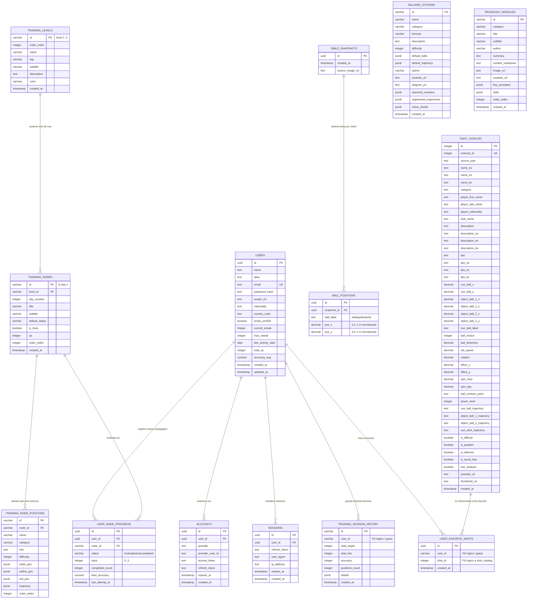

# 🗄️ Estructura de Base de Datos - Bandaro Monorepo

Este documento describe de forma exhaustiva el modelo de datos relacional de la plataforma **Bandaro (Billar a Tres Bandas)**, gestionado con **PostgreSQL** y **Drizzle ORM**.

---

## 1. Diagrama Entidad-Relación (Mermaid ERD)

El siguiente diagrama ilustra todas las tablas de la base de datos, sus claves primarias (`PK`), claves foráneas (`FK`), atributos principales y cardinalidades.

---

## 2. Especificación Detallada de Módulos y Tablas

### Módulo 1: Usuarios y Autenticación

#### Tabla: `users`
Centraliza los perfiles de deportistas, métricas globales de juego, racha diaria y experiencia acumulada (XP).

| Campo | Tipo | Nulo | Default | Descripción |
|---|---|:---:|---|---|
| `id` | `UUID` | No | `gen_random_uuid()` | Identificador único del usuario. Clave Primaria. |
| `name` | `TEXT` | No | - | Nombre completo del jugador. |
| `alias` | `TEXT` | No | - | Apodo o identificador deportivo único en la comunidad. |
| `email` | `TEXT` | No | - | Correo electrónico único para inicio de sesión. |
| `password_hash` | `TEXT` | Sí | `NULL` | Hash bcrypt de contraseña (nulo si solo usa OAuth). |
| `avatar_url` | `TEXT` | No | `'avatar-01'` | Identificador o URL del avatar gráfico. |
| `nationality` | `TEXT` | No | `'Colombia'` | País de representación. |
| `country_code` | `TEXT` | No | `'CO'` | Código ISO-3166 alfa-2 para banderas. |
| `email_verified`| `BOOLEAN` | Sí | `false` | Indica si validó su correo vía token. |
| `current_streak`| `INTEGER` | No | `0` | Días consecutivos entrenando activamente. |
| `max_streak` | `INTEGER` | No | `0` | Récord histórico de días consecutivos. |
| `last_activity_date` | `DATE` | Sí | `NULL` | Fecha del último entrenamiento para calcular rachas. |
| `total_xp` | `INTEGER` | No | `0` | Puntos de experiencia acumulados. |
| `accuracy_avg` | `NUMERIC(5,2)` | No | `'0.00'` | Porcentaje promedio global de carambolas logradas (0.00 a 100.00). |
| `created_at` | `TIMESTAMPTZ` | No | `now()` | Fecha de registro. |
| `updated_at` | `TIMESTAMPTZ` | No | `now()` | Fecha de última modificación. |

**Índices:**
- `users_email_idx` en `email`.

---

#### Tabla: `accounts`
Soporta proveedores de identidad federada (OAuth 2.0: Google, Microsoft).

| Campo | Tipo | Nulo | Default | Descripción |
|---|---|:---:|---|---|
| `id` | `UUID` | No | `gen_random_uuid()` | PK de la cuenta vinculada. |
| `user_id` | `UUID` | No | - | FK hacia `users.id` con eliminación en cascada (`ON DELETE CASCADE`). |
| `provider` | `TEXT` | No | - | Nombre del proveedor (`'google'`, `'microsoft'`). |
| `provider_user_id` | `TEXT` | No | - | ID único retornado por el proveedor OAuth. |
| `access_token` | `TEXT` | Sí | `NULL` | Token de acceso vigente. |
| `refresh_token`| `TEXT` | Sí | `NULL` | Token de refresco del proveedor. |
| `expires_at` | `TIMESTAMPTZ` | Sí | `NULL` | Expiración del token OAuth. |
| `created_at` | `TIMESTAMPTZ` | No | `now()` | Registro de vinculación. |

**Índices:**
- `accounts_user_id_idx` en `user_id`.
- `accounts_provider_idx` en `(provider, provider_user_id)`.

---

#### Tabla: `sessions`
Gestiona sesiones activas y rotación segura de Refresh Tokens JWT.

| Campo | Tipo | Nulo | Default | Descripción |
|---|---|:---:|---|---|
| `id` | `UUID` | No | `gen_random_uuid()` | PK de sesión. |
| `user_id` | `UUID` | No | - | FK hacia `users.id` (`ON DELETE CASCADE`). |
| `refresh_token`| `TEXT` | No | - | Token de refresco criptográfico firmado. |
| `user_agent` | `TEXT` | Sí | `NULL` | Cliente del dispositivo (Mobile iOS/Android o Web Browser). |
| `ip_address` | `TEXT` | Sí | `NULL` | Dirección IP de conexión. |
| `expires_at` | `TIMESTAMPTZ` | No | - | Fecha de caducidad de la sesión. |
| `created_at` | `TIMESTAMPTZ` | No | `now()` | Momento de login. |

---

### Módulo 2: Ruta de Aprendizaje Pedagógica (Método José María Quetglas)

#### Tabla: `training_levels`
Define los 5 niveles maestros de formación biomecánica y táctica.

| Campo | Tipo | Nulo | Default | Descripción |
|---|---|:---:|---|---|
| `id` | `VARCHAR(50)` | No | - | PK mnemónica (`'level-1'`, `'level-2'`, `'level-3'`, `'level-4'`, `'level-5'`). |
| `order_index` | `INTEGER` | No | - | Orden de progresión estricta (1 al 5). |
| `name` | `VARCHAR(100)` | No | - | Nombre del nivel (e.g., *Nivel 1: Fundamentos y Mecánica de Golpe*). |
| `tag` | `VARCHAR(50)` | No | - | Etiqueta corta (e.g., *Iniciación*, *Avanzado*). |
| `subtitle` | `VARCHAR(150)` | No | - | Resumen pedagógico del nivel. |
| `description` | `TEXT` | No | - | Explicación detallada de objetivos y metas. |
| `color` | `VARCHAR(20)` | No | - | Código hexadecimal del color temático (e.g., `'#00E5FF'`). |
| `created_at` | `TIMESTAMPTZ` | No | `now()` | Fecha de creación. |

---

#### Tabla: `training_nodes`
Representa cada día o estación dentro de un nivel pedagógico (40+ días en total).

| Campo | Tipo | Nulo | Default | Descripción |
|---|---|:---:|---|---|
| `id` | `VARCHAR(80)` | No | - | PK mnemónica (e.g., `'l1-day-1'`, `'l2-day-15'`). |
| `level_id` | `VARCHAR(50)` | No | - | FK hacia `training_levels.id` (`ON DELETE CASCADE`). |
| `day_number` | `INTEGER` | No | - | Número secuencial del día. |
| `title` | `VARCHAR(150)` | No | - | Título de la sesión formativa. |
| `subtitle` | `VARCHAR(255)` | No | - | Resumen de los tiros a practicar. |
| `default_status` | `VARCHAR(20)` | No | `'locked'` | Estado inicial (`'locked'`, `'active'`). |
| `is_boss` | `BOOLEAN` | No | `false` | `true` si es la prueba evaluativa final de nivel (Boss Battle). |
| `xp` | `INTEGER` | No | `100` | Experiencia que otorga al completarse. |
| `order_index` | `INTEGER` | No | - | Orden dentro del nivel. |
| `created_at` | `TIMESTAMPTZ` | No | `now()` | Registro del nodo. |

---

#### Tabla: `training_node_positions`
Define las posiciones exactas de las bolas en la mesa para cada ejercicio del día.

| Campo | Tipo | Nulo | Default | Descripción |
|---|---|:---:|---|---|
| `id` | `VARCHAR(80)` | No | - | PK del ejercicio (e.g., `'l1-d1-p1'`). |
| `node_id` | `VARCHAR(80)` | No | - | FK hacia `training_nodes.id` (`ON DELETE CASCADE`). |
| `name` | `VARCHAR(150)` | No | - | Nombre técnico (e.g., *Cajón clásico con 2 bandas*). |
| `category` | `VARCHAR(80)` | No | - | Familia (e.g., `'cajon'`, `'bricole'`, `'pasebola'`). |
| `hint` | `TEXT` | Sí | `NULL` | Pistas tácticas y biomecánicas de Quetglas. |
| `difficulty` | `INTEGER` | No | `3` | Escala de dificultad de 1 a 5. |
| `white_pos` | `JSONB` | No | - | Coordenadas canónicas `{ x: number, y: number }` en cm (0 a 284, 0 a 142). |
| `yellow_pos` | `JSONB` | No | - | Coordenadas canónicas `{ x: number, y: number }` de bola amarilla. |
| `red_pos` | `JSONB` | No | - | Coordenadas canónicas `{ x: number, y: number }` de bola roja. |
| `trajectory` | `JSONB` | Sí | `NULL` | Puntos guía opcionales de la carambola ideal. |
| `order_index` | `INTEGER` | No | `0` | Orden del ejercicio dentro del día. |

---

#### Tabla: `user_node_progress`
Registra el progreso individual del jugador en cada nodo de la ruta.

| Campo | Tipo | Nulo | Default | Descripción |
|---|---|:---:|---|---|
| `id` | `UUID` | No | `gen_random_uuid()` | PK de progreso. |
| `user_id` | `UUID` | No | - | FK a `users.id` (`ON DELETE CASCADE`). |
| `node_id` | `VARCHAR(80)` | No | - | FK a `training_nodes.id` (`ON DELETE CASCADE`). |
| `status` | `VARCHAR(20)` | No | `'locked'` | Estado del nodo para este usuario: `'locked'`, `'active'`, `'completed'`. |
| `stars` | `INTEGER` | No | `0` | Calificación de 0 a 3 estrellas según precisión. |
| `completed_count` | `INTEGER` | No | `0` | Veces que ha completado con éxito el nodo. |
| `best_accuracy` | `NUMERIC(5,2)`| No | `'0.00'` | Mejor porcentaje de acierto registrado. |
| `last_attempt_at` | `TIMESTAMPTZ`| No | `now()` | Fecha y hora del último intento. |

**Restricciones e Índices:**
- `user_node_unique_idx`: Índice único sobre `(user_id, node_id)`.

---

### Módulo 3: Sistemas Clásicos y Pedagogía Teórica

#### Tabla: `billiard_systems`
Enciclopedia interactiva de sistemas de diamantes (Tuzul, Sistema Clásico, Cuaderno Maestro, Hoppe).

| Campo | Tipo | Nulo | Default | Descripción |
|---|---|:---:|---|---|
| `id` | `VARCHAR(60)` | No | - | PK (e.g., `'tuzul-classic'`, `'hoppe-clock'`). |
| `name` | `VARCHAR(100)` | No | - | Nombre oficial del sistema. |
| `category` | `VARCHAR(80)` | No | - | Categoría de tiro (e.g., *Banda Previa*, *Rodadas*, *Pasebolas*). |
| `formula` | `VARCHAR(150)` | No | - | Expresión matemática (e.g., `Ataque = Salida - Llegada`). |
| `description` | `TEXT` | No | - | Guía de aplicación práctica en mesa. |
| `difficulty` | `INTEGER` | No | `3` | Nivel de complejidad (1 al 5). |
| `default_balls`| `JSONB` | No | - | Posición por defecto de las 3 bolas. |
| `default_trajectory`| `JSONB` | Sí | `NULL` | Segmentos vectoriales de la trayectoria de referencia. |
| `author` | `VARCHAR(100)` | Sí | `NULL` | Creador o compilador del sistema. |
| `youtubeUrl` | `TEXT` | Sí | `NULL` | Enlace a video demostrativo. |
| `diagram_url` | `TEXT` | Sí | `NULL` | Diagrama ilustrativo complementario. |
| `diamond_numbers` | `JSONB` | Sí | `NULL` | Numeración de diamantes proyectada en las 4 bandas. |
| `segmented_trajectories` | `JSONB` | Sí | `NULL` | Variantes del sistema según punto de salida/ataque. |
| `cheatSheets` | `JSONB` | Sí | `NULL` | Tablas de compensación por velocidad o paño. |
| `created_at` | `TIMESTAMPTZ` | No | `now()` | Fecha de registro. |

---

#### Tabla: `pedagogy_modules`
Biblioteca teórica del método Quetglas (postura, puente, limado, agarre del taco, biomecánica del impacto).

| Campo | Tipo | Nulo | Default | Descripción |
|---|---|:---:|---|---|
| `id` | `VARCHAR(80)` | No | - | PK del módulo pedagógico. |
| `category` | `VARCHAR(60)` | No | - | Área temática (`biomecanica`, `mental`, `estrategia`). |
| `title` | `VARCHAR(150)` | No | - | Título de la lección. |
| `subtitle` | `VARCHAR(255)` | No | - | Breve introducción. |
| `author` | `VARCHAR(100)` | No | - | Autor (e.g., *José María Quetglas*). |
| `summary` | `TEXT` | No | - | Resumen ejecutivo. |
| `content_markdown` | `TEXT` | No | - | Contenido enriquecido completo en Markdown. |
| `image_url` | `TEXT` | Sí | `NULL` | Fotografía o diagrama ilustrativo. |
| `key_principles`| `JSONB` | Sí | `NULL` | Lista de puntos clave a memorizar. |
| `drills` | `JSONB` | Sí | `NULL` | Rutinas físicas y ejercicios específicos. |
| `order_index` | `INTEGER` | No | `0` | Orden de lectura recomendado. |

---

### Módulo 4: Catálogo Maestro de Carambolas (`shot_catalog`)

Contiene la base de datos de más de 180 carambolas de maestros mundiales (Caudron, Blomdahl, Merckx, Sayginer), traducidas trilingüemente (Español, Inglés y Coreano) con parámetros de física 1:1.

| Campo | Tipo | Nulo | Default | Descripción |
|---|---|:---:|---|---|
| `id` | `INTEGER` | No | - | Clave Primaria secuencial. |
| `external_id` | `INTEGER` | No | - | ID único de origen (e.g., Play # de Billiard Bible). |
| `source_type` | `TEXT` | No | `'analysis'` | Tipo de fuente (`'analysis'`, `'tournament'`). |
| `name_es` / `en` / `ko` | `TEXT` | No / Sí | - | Nombre de la jugada en ES, EN, KO. |
| `category` | `TEXT` | No | - | Categoría canónica (16 familias: *Larga-Corta-Larga*, *Bricole*, *Pasebola*, *Cajón*, etc.). |
| `player_first_name` / `last_name` | `TEXT` | Sí | `NULL` | Maestro que ejecutó la jugada. |
| `player_nationality` | `TEXT` | Sí | `NULL` | Nacionalidad del jugador. |
| `cue_ball_x`, `cue_ball_y` | `DECIMAL(8,4)` | No | - | Posición bola tiradora en mesa canónica (cm: 0..284, 0..142). |
| `object_ball_1_x`, `y` | `DECIMAL(8,4)` | No | - | Posición de la 1ª bola objetivo. |
| `object_ball_2_x`, `y` | `DECIMAL(8,4)` | No | - | Posición de la 2ª bola objetivo. |
| `cue_ball_label` | `TEXT` | No | `'white'` | Bola elegida como tiradora (`'white'` o `'yellow'`). |
| `ball_choice` | `INTEGER` | No | `1` | Orden táctico recomendado para atacar bola 1 o bola 2. |
| `ball_thickness` | `DECIMAL(6,3)` | No | - | Grosor de bola (fracción de 0.000 a 1.000, e.g. `0.500` = media bola). |
| `rail_speed` | `DECIMAL(4,2)` | No | `'2.0'` | Velocidad en Largos de Mesa (1.0 a 5.0). Calibrada 1:1 con potencia física. |
| `rotation` | `DECIMAL(8,3)` | Sí | `NULL` | Rotación angular o efecto neto. |
| `effect_x`, `effect_y` | `DECIMAL(6,4)` | Sí | `NULL` | Coordenadas cartesianas $[-1, 1]$ del punto de contacto en la bola. |
| `spin_hour` | `DECIMAL(4,2)` | Sí | `NULL` | Reloj de efecto (1.0 a 12.0). |
| `spin_tips` | `DECIMAL(4,2)` | Sí | `NULL` | Puntas de suela de efecto (0.0 a 3.0). |
| `power_level` | `INTEGER` | No | `2` | Nivel de fuerza sugerido (1: Suave, 2: Medio, 3: Fuerte, 4: Máximo). |
| `cue_ball_trajectory` | `TEXT` | No | - | Cadena de puntos de la trayectoria de la bola tiradora. |
| `is_difficult` | `BOOLEAN` | Sí | `false` | Bandera de alta complejidad. |
| `is_position` | `BOOLEAN` | Sí | `false` | Diseñado para dejar posición favorable (reagrupamiento). |
| `is_defense` | `BOOLEAN` | Sí | `false` | Diseñado para defensa si se erra. |
| `is_avoid_kiss` | `BOOLEAN` | Sí | `false` | Requiere esquivar choque entre bolas (retruque). |
| `youtube_url` | `TEXT` | Sí | `NULL` | Video real del tiro en torneo. |

---

### Módulo 5: Visión Artificial y Calibración de Mesa (`table_snapshots` y `ball_positions`)

Permite digitalizar mesas reales a partir de fotos de celular usando homografía proyectiva $H$.

#### Tabla: `table_snapshots`
Registra la captura fotográfica inicial.
- `id` (`UUID`, PK).
- `source_image_url` (`TEXT`): Imagen original almacenada en servidor o CDN.
- `created_at` (`TIMESTAMPTZ`): Marca temporal.

#### Tabla: `ball_positions`
Almacena las coordenadas normalizadas detectadas $[0.0, 1.0]$ relativas al rectángulo interior de las bandas:
- `id` (`UUID`, PK).
- `snapshot_id` (`UUID`, FK a `table_snapshots.id` con `ON DELETE CASCADE`).
- `ball_label` (`TEXT`): `'white'`, `'yellow'`, `'red'`.
- `pos_x`, `pos_y` (`DECIMAL(5,4)`): Coordenadas normalizadas $(x, y) \in [0.0000, 1.0000]$.

---

## 3. Convenciones Técnicas de Migración y Semillas
1. **Drizzle Kit:** Esquema centralizado en `backend/src/db/schema.ts`.
2. **Semillado:** `backend/src/db/seed.ts` puebla los 5 niveles pedagógicos, las carambolas del catálogo con traducciones completas y los sistemas clásicos de diamantes.
3. **Tipos e Integridad:** Claves foráneas con eliminación en cascada protegen la integridad referencial en cuentas, sesiones y progresos de usuario.
