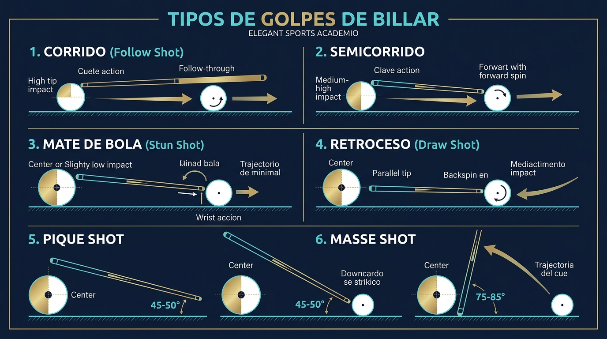
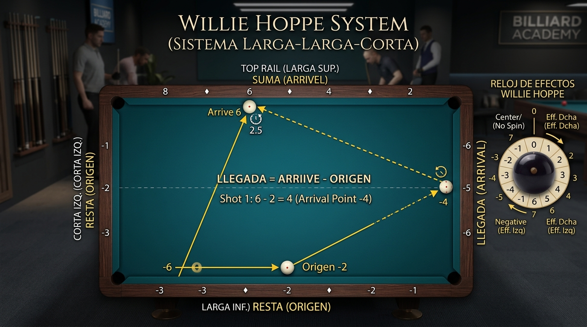

# 🎱 Cuaderno Maestro de Investigación: Billar a Tres Bandas
> **Compendio Teórico, Biomecánico y Geométrico**  
> *Basado en las obras maestras y metodologías de: Marco Zanetti, José María Quetglas, Raymond Ceulemans, Frédéric Caudron, Torbjörn Blomdahl y AM Billiard Academy.*

---

## 📚 1. Bibliografía Maestra y Autores Canónicos

| Autor / Maestro | Obra / Escuela | Aportación Fundamental |
| :--- | :--- | :--- |
| **José María Quetglas** *(España)* | *"El billar no es de azar"*, Director Técnico CAR Los Narejos / RFEB | Biomecánica pura: anclaje de pies a 45°, ojo maestro en el eje del tiro, brazo pendular a 90°, limaje con aceleración constante sin contracción muscular parásita. |
| **Marco Zanetti** *(Italia)* | Múltiple Campeón Mundial UMB (2002, 2013), Tratados de Técnica Moderna | Perfeccionamiento del puente cerrado con anilla firme, apoyo de 4 dedos en trípode bajo, distribución estricta de balance 60/40, soltura de culata en la penetración. |
| **Raymond Ceulemans ("Mister 100")** *(Bélgica)* | *"Mister 100"* (1979) — La Biblia histórica del billar | Estandarización del reloj de efectos (12h, 1h, 2h, 3h), tomas de bola en octavos (1/8 a bola llena), formulación original del Sistema Clásico de Diamantes. |
| **Frédéric Caudron** *(Bélgica)* | Enciclopedia de Sistemas de Carambola | Sistemas matemáticos avanzados: Base 50, Sistema Plus (Plus Two), Sistema Sin Efecto (rectángulos/túneles), Bricoles de corta y larga. |
| **Torbjörn Blomdahl** *(Suecia)* | 6 veces Campeón Mundial | Dinámica moderna del paño rápido: juego dinámico, aceleraciones cortas, efectos con contracurva y control de elasticidad de bandas. |
| **AM Billiard Academy** *(Canal Educativo)* | Didáctica Geométrica Audiovisual | Descomposición de trayectorias canónicas por tramos de color (1ª-3ª banda, 3ª-4ª banda, 4ª-5ª banda), Cheat Sheets de salidas (Salida 50, 40, 30, 60). |

---

## 🧘 2. Biomecánica Corporal y Postura (Marco Zanetti & J.M. Quetglas)

### 2.1 El Triángulo de Anclaje de Pies
1. **Línea de Tiro:** Es la línea imaginaria que conecta la bola jugadora con el objetivo.
2. **Pie de Apoyo (retrasado - diestro: derecho):** Se sitúa **exactamente sobre la línea de tiro**, formando un ángulo de **45° a 60°** hacia el exterior.
3. **Pie Director (adelantado - diestro: izquierdo):** Se adelanta a la anchura de los hombros, orientado hacia la mesa, con rodilla semiflexionada para amortiguar y estabilizar el centro de gravedad.
4. **Reparto de Masas:** 
   - **60% del peso** en la pierna retrasada (eje ancla).
   - **40% del peso** en la pierna adelantada (eje equilibrio).
   - *Nunca balancear el cuerpo hacia adelante durante el limaje*.

### 2.2 Eje Visual y Ojo Dominante
- El tronco desciende desde las caderas manteniendo la columna vertebral recta.
- La barbilla debe ubicarse a **10–15 cm** por encima del taco (en rasantes, casi rozándolo).
- El taco se sitúa directamente bajo el **ojo dominante** (o exactamente en el plano medio bifocal para visión centrada).

### 2.3 El Brazo Pendular y Agarre de la Culata
- **Articulación de hombro:** Completamente fija y bloqueada.
- **Brazo superior (húmero):** Horizontal y paralelo al suelo.
- **Antebrazo:** Oscila como un péndulo de gravedad puro. En el **momento del impacto**, el antebrazo debe formar un ángulo recto de **90° con el taco**.
- **Mano en la Culata:** Sujeción elástica entre pulgar, índice y corazón. Los nudillos no deben apretarse; apretar la culata eleva la flecha y deforma el tiro.

---

## ✋ 3. Tipos Canónicos de Puentes

### 3.1 Puente Cerrado con Anilla (Closed Loop Bridge)
- **Construcción:** El dedo índice envuelve la flecha del taco cerrando contra la yema del pulgar, creando un anillo cerrado perfecto. Los dedos corazón, anular y meñique se abren en abanico apoyando las yemas firmemente en el paño.
- **Uso:** El 85% de las jugadas de 3 bandas (fuerza 2 a 5). Impide que el taco se desvíe o se levante al aplicar aceleración.
- **Distancia bola-puente:** 15 a 22 cm según la fuerza del golpe.

### 3.2 Puente Abierto en "V" (Open V-Bridge)
- **Construcción:** La palma apoya el talón sobre el paño, el dedo pulgar se apoya contra el nudillo o lateral del dedo índice formando una hendidura en "V".
- **Uso:** Tiros a distancia, rodadas suaves (fuerza 1-2), jugadas de reunión o cuando una bola vecina impide cerrar la mano.

### 3.3 Puente sobre Banda (Rail Bridge)
- **Construcción:** Cuando la bola jugadora está a menos de 10 cm de la banda de madera:
  - El talón de la mano apoya sobre el pasamanos.
  - El índice o pulgar fija el taco contra el filo de la banda.
- **Regla crítica:** Mantener el taco lo más horizontal posible para evitar efectos parabólicos parásitos.

### 3.4 Puente Elevado (Elevated / Piqué Bridge)
- **Construcción:** Dedos en forma de trípode elevado (araña), palma a 8-12 cm sobre el paño.
- **Uso:** Para saltar una bola intermedia o ejecutar tiros con piqué/retroceso pronunciado.

---

## ⚪ 4. Geometría de Tomas de Bola (Ball Thicknesses)

En el billar a tres bandas, el espesor de bola que contacta la bola 1 con la bola 2 determina tanto el ángulo de separación natural como la velocidad transmitida:

| Espesor (Tome) | Desviación de Bola 1 | Velocidad transmitida a Bola 2 | Aplicación Típica |
| :--- | :--- | :--- | :--- |
| **1/8 (Fina / Rozada)** | ~10° - 15° | ~10% (casi nula) | Bricoles interiores, cabañas muy abiertas |
| **1/4 (Cuarto de bola)** | ~25° - 30° | ~25% | Cabañas estándar, rodadas cortas |
| **1/2 (Media bola)** | ~35° - 42° | ~50% (reparto parejo) | Pasabolas, sistema base 50 sobre bola |
| **3/4 (Tres cuartos)** | ~50° - 60° | ~75% (mucha cesión) | Retrocesos moderados, amortiguamientos |
| **Llena (100%)** | 0° (o retroceso directo) | ~95% - 100% | Retros plenos, jugadas de fuerza viva |

---

## 📐 5. Sistemas Canónicos y Geometría de Diamantes

### 5.1 Sistema Base 50 (Sistema Clásico de 3 Bandas / Sistema Conti)
- **Fórmula Universal:**
  $$\text{Llegada (3ª Banda)} = \text{Salida (Banda Larga)} - \text{Ataque (1ª Banda Larga)}$$
- **Numeración de Diamantes:**
  - **Banda de Ataque (1ª banda):** $10, 20, 30, 40, 50, 60, 70, 80$ (de izquierda a derecha / esquina opuesta).
  - **Banda de Salida (3ª banda larga):** $50$ (esquina), $40, 30, 20$ (hacia el centro) o $60, 70, 80$ (más allá de la esquina).
  - **Banda de Llegada (3ª banda corta):** $10, 20, 30, 40$ (cada diamante vale 10 puntos de llegada).
- **Proyección a 4ª y 5ª Banda (AM Billiard Academy):**
  - **Llegada en 3ª banda de 20:** Proyecta en 4ª banda larga hacia el diamante 20 y busca el rincón opuesto en 5ª banda.
  - **Llegada en 3ª banda de 30:** Proyecta en 4ª banda hacia el diamante 30 y sube a 5ª banda en línea paralela.
- **Segmentación Visual de Colores:**
  - 🔵 **Tramo 1 (1ª a 3ª banda):** Azul / Cian brillante — El corazón de la fórmula matemática.
  - 🟡 **Tramo 2 (3ª a 4ª banda):** Ámbar / Dorado — El rebote con efecto natural (rotación 2 a 3 tips).
  - 🟢 **Tramo 3 (4ª a 5ª banda):** Verde Esmeralda — Recorrido final hacia la carambola en cabaña o pasabola.

### 5.2 Cheat Sheet de Salidas Base 50
- **Partiendo de Salida 50:**
  - $50 - 10 = 40$ (Llegada al rincón en 3ª banda).
  - $50 - 20 = 30$ (Llegada al diamante 3 en corta).
  - $50 - 30 = 20$ (Llegada al diamante 2 en corta).
  - $50 - 40 = 10$ (Llegada al diamante 1 en corta).
  - $50 - 50 = 0$ (Llegada al rincón superior).
- **Partiendo de Salida 40:**
  - $40 - 10 = 30$
  - $40 - 20 = 20$
  - $40 - 30 = 10$
- **Partiendo de Salida 60:**
  - $60 - 20 = 40$
  - $60 - 30 = 30$
  - $60 - 40 = 20$

---

## 🎬 6. Recursos Audiovisuales y Enlaces Canónicos
- **Técnica & Postura:** [YouTube - Fundamentos de Postura y Biomecánica](https://www.youtube.com/watch?v=gjLRHztVPGc&list=PLBDeKPPnG5qQ9ve1PX8GOOLtKiApUkJcQ&index=56)
- **AM Billiard Academy:** [YouTube - AM Billiard Academy](https://www.youtube.com/@ambilliardacademy)
- **El Flaco Billarista (Jaime Carrasco):** [YouTube - El Flaco Billarista](https://www.youtube.com/@elflacobillarista)
- **Sistema Larga-Larga-Corta Hope (Ep. 130):** [YouTube - Sistema LLK Willie Hope](https://www.youtube.com/watch?v=jeAREkYyN3A)
- **Sistemas de Diamantes & Trayectorias:** [YouTube - Sistema Base 50 y Proyecciones](https://www.youtube.com/watch?v=HGfTj9vQTpY)
- **Tome de Bola y Ataque:** [YouTube - Fundamentos y Tomas de Bola](https://www.youtube.com/watch?v=JRHH0i9uGzI)

---

## 💥 7. Tipos de Golpes de Billar (Mecánica y Biomecánica de Ataque)

El éxito en el billar a tres bandas reside en que la bola jugadora reaccione con la rotación y velocidad dinámicas precisas tras el choque con la bola 2 o con la banda:

### 7.1 Corrido (Follow Through)
- **Punto de impacto:** Polo superior de la bola (1 a 2 puntas de suela sobre el centro ecuatorial).
- **Mecánica del tiro:** Taco horizontal, limaje amplio y flexible, aceleración continua hacia adelante a través de la bola.
- **Efecto dinámico:** La bola adquiere rotación de avance hacia adelante (topspin). Al impactar la bola 2, conserva inercia de rodaje y continúa su trayectoria hacia adelante.
- **Cuándo se usa:** En pases de bola perimétricos, rodadas largas y cuando se necesita abrir o alargar el recorrido natural sin pérdida prematura de velocidad.

### 7.2 Semicorrido
- **Punto de impacto:** Entre el centro ecuatorial y el polo superior (1 punta arriba).
- **Mecánica del tiro:** Avance moderado y controlado con toque intermedio.
- **Cuándo se usa:** Para rodadas estándar y carambolas de desahogo donde no se requiere una inercia violenta que descoloque las bolas.

### 7.3 Mate de Bola (Bola Muerta / Stun Shot)
- **Punto de impacto:** En el centro exacto o apenas 2 mm debajo del ecuador.
- **Mecánica del tiro:** Golpe seco y firme con muñeca firme ("muñeca seca"), deteniendo el taco exactamente en el punto de contacto.
- **Efecto dinámico:** Se transfiere casi el 100% de la energía viva a la bola 2. La bola tacadora se despoja de rotación parasitaria y se desplaza suavemente por la **tangente geométrica pura de 90°**.
- **Cuándo se usa:** En cajones cortos, jugadas de colocación y para evitar que la bola 2 tome velocidad desmedida y choque con las demás (retener el cuadro).

### 7.4 Retroceso (Jale / Retraque / Draw Shot)
- **Punto de impacto:** Tercio inferior de la bola (polo sur).
- **Mecánica del tiro:** Taco estrictamente paralelo a la mesa (no inclinar el taco más de 10°). Muñeca relajada que "suelta" el taco al impactar.
- **Efecto dinámico:** Backspin violento. Tras el impacto con la bola 2, la tacadora frena en seco y retrocede en línea recta o en ángulo agudo.
- **Cuándo se usa:** Para resolver ángulos cerrados que no pueden alcanzarse por rebote natural, retrocesos directos a banda corta y tiros de repetición.

### 7.5 Piqué
- **Punto de impacto:** Centro o polo inferior con el taco inclinado a **40°–60°**.
- **Mecánica del tiro:** Golpe de arriba hacia abajo para provocar un retroceso instantáneo o una curva de radio corto.
- **Cuándo se usa:** Cuando la bola blanca está a menos de 10 cm de la bola 2 y un retroceso plano provocaría falta por doble golpe (reteñido), o para curvas cortas inmediatas.

### 7.6 Masé (Massé)
- **Punto de impacto:** Lateral superior/medio con el taco inclinado verticalmente a **75°–85°**.
- **Mecánica del tiro:** La suela ataca de arriba hacia abajo comprimiendo la bola contra el paño. La fricción transversal produce una **curvatura parabólica cerrada en el paño sin necesidad de tocar bandas**.
- **Cuándo se usa:** Para esquivar bolas obstáculo que tapan la línea de tiro directa y resolver carambolas aparentemente imposibles.

### 7.7 Penetración de la Bola (Acompañamiento Canónico)
- **Regla de oro de Zanetti y Quetglas:** El taco nunca debe frenarse como un martillo al golpear la bola blanca, sino **atravesar la esfera entre 15 y 25 cm después del impacto**. Esto transfiere una aceleración continua, elimina vibraciones en la flecha y estabiliza el rodaje de la bola sobre el paño.

---

## 🇨🇴 8. Nomenclatura Tradicional de Carambolas en Colombia & Latinoamérica

En Colombia y el circuito latinoamericano, los maestros y jugadores utilizan una terminología descriptiva propia para catalogar las familias de jugadas:

| Término Tradicional | Recorrido / Familia | Descripción Técnica |
| :--- | :--- | :--- |
| **Rodada** | Larga - Corta - Larga (L-C-L) | Jugada fundamental. La tacadora toma bola 2 a medio cuerpo o 3/4 y rueda hacia adelante entrando a banda larga, corta y larga hacia la bola 3. |
| **Cajón (Cabaña)** | Corta - Larga - Corta (C-L-C) | La reina del cuadro pequeño. Entrada por la banda corta más próxima, corre por la larga y dobla en la corta siguiente con mate o efecto 4. |
| **Pase Bola** | Larga - Corta - Larga - Corta (L-C-L-C) | Corrido perimétrico de 4 o 5 bandas donde la bola blanca pasa por delante o alrededor de la bola 2 para dar la vuelta completa a la mesa. |
| **Renversé** | Contrabanda / Inversión | Golpe con efecto contrario al sentido del giro natural. La bola "muerde" la primera banda e invierte drásticamente el ángulo de apertura. |
| **Serrucho (Cerrucho)** | Vaivén entre bandas | Trayectoria de ida y vuelta que va y viene entre bandas paralelas con efecto violento, simulando los dientes de una sierra. |
| **Zigzag (Zik-Zak)** | Cruce en Z | Recorrido diagonal en Z entre bandas opuestas cruzando la mesa de un rincón a otro. |
| **Retroceso (Jale / Retraque)** | Retroceso angular | Ataque bajo en polo sur para que la tacadora retroceda tras impactar bola 2. |
| **Tornillo** | Efecto extremo rotacional | Tiro con fuerte efecto lateral (a menudo con taco semielevado) donde la bola gira sobre sí misma y quiebra bruscamente al tocar la banda. |
| **Tiki (Tiki-Taki)** | Banda y Bola / Doble contacto | Sistema para cuando la bola 2 está pegada a la banda larga o se aprovecha el doble contacto controlado para empujar hacia la carambola. |
| **Bricole** | Banda previa | Entrada impactando primero en bandas antes de tocar cualquier bola (1, 2 o 3 bandas previas). |

---

## 🎯 9. Sistema Larga-Larga-Corta (LLK) & Reloj de Efectos de Willie Hoppe

*(Canal El Flaco Billarista - Jaime Carrasco, Episodio 130: "Sistema de billar Larga-larga corta Hope")*

### 9.1 Propósito del Sistema LLK
Permite resolver carambolas donde la bola jugadora contacta la bola 2 y debe cruzar entre las dos bandas largas opuestas (Larga 1 $\rightarrow$ Larga 2) para finalizar en la banda corta de llegada (Corta 3) y conectar con la bola 3.

### 9.2 Numeración de la Mesa (Método Willie Hoppe)
- **Banda Larga Superior ("Suma"):** Los diamantes se numeran de **2 en 2**:
  $$\text{Diamante 1} = 2, \quad \text{Diamante 2} = 4, \quad \text{Diamante 3} = 6, \quad \text{Diamante 4} = 8$$
- **Banda Corta Izquierda ("Resta" / Llegada):** Numerada como $-1, -2, -3$ (hacia abajo).
- **Banda Corta Derecha ("Resta" / Salida de Cabecera):** Numerada como $-4, -5, -6$.
- **Banda Larga Inferior ("Resta"):** Ajustes $-1, -2, -3$.

### 9.3 Fórmula Canónica
$$\text{Llegada} = \text{Suma (Banda Larga)} - \text{Resta (Salida / Cabecera)}$$

*Ejemplo clásico del Episodio 130:*
- Bola 2 situada en el diamante 2 de banda larga superior $\rightarrow \text{Suma} = 4$.
- Taco alineado desde la banda corta derecha en $-4$.
- Llegada proyectada en banda corta izquierda: $\text{Llegada} = -2$ (donde espera la bola roja).
- Efecto: Efecto 2 de Willie Hoppe con golpe penetrado suave a 1/4 de bola.

### 9.4 El Reloj de Efectos de Willie Hoppe
El sistema Hoppe divide la bola en un cuadrante firmado con números exactos:
- **`0` (12:00):** Corrido puro al centro-arriba sin desvío lateral.
- **`+1` (1:00):** Fino a favor a la derecha.
- **`+2` (2:00):** Efecto estándar natural para rodadas y cruces LLK.
- **`+3` (2:30):** Efecto medio alto para abrir ángulo.
- **`+4` (3:00):** Efecto ecuatorial lateral derecho pleno (máxima reacción en banda).
- **`+5` (4:00):** Efecto bajo lateral derecho con agarre en paño.
- **`+6` (5:00):** Jale lateral pronunciado.
- **`+7` (6:00):** Máximo retroceso / jale en el polo sur.
- **`-1` (11:00):** Contrario fino arriba a la izquierda.
- **`-2` (10:00):** Contrario medio para renversé o contrabanda.
- **`-3` (9:00):** Máximo contrario ecuatorial lateral izquierdo pleno.
- **`-4` (8:00):** Contrario bajo con retención.
- **`-5` (7:00):** Jale izquierdo profundo.

